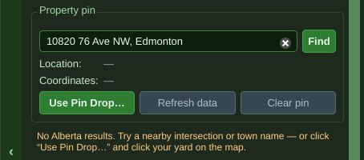
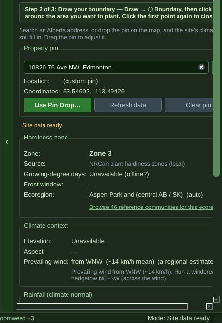
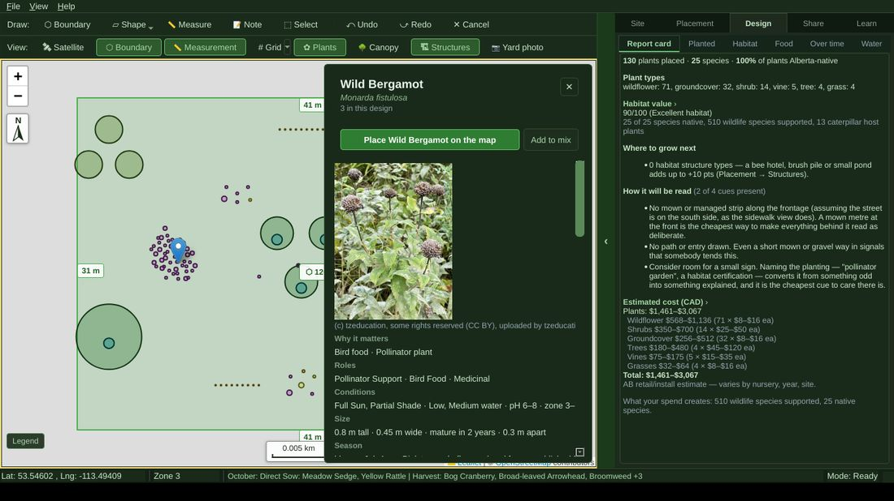
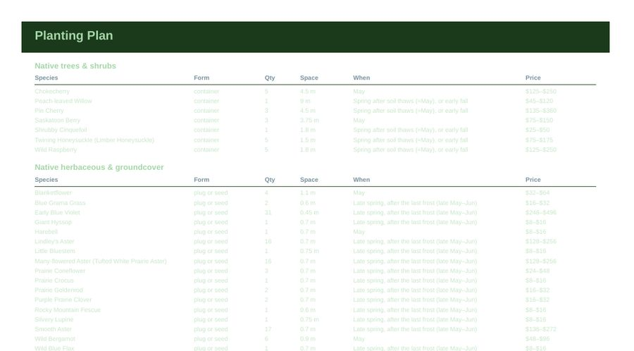
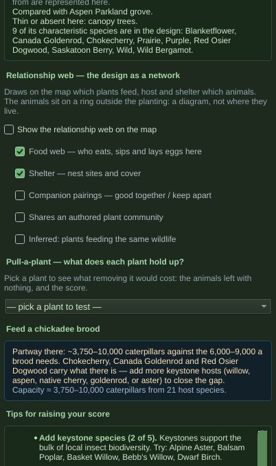

# Ready to sell? A review of Site & Pattern at V3.17

*Asked for by the owner on 12 October 2026: "a full thorough user experience
directed review to analyze what remains to be done to make this polished to a
point I could literally sell it", for "an individual that does not know much
about native plants or landscaping but wants to landscape with native plants",
including whether the app is too busy, and whether it should be Edmonton only.
No code was changed. Every finding below names where it lives, so each can be
picked up as its own increment.*

Findings carry **R-numbers** (review items). They are not feature IDs: when one
is scheduled, take its F-number from the ledger in `ROADMAP_NEXT.md`.

---

## The short answer

1. **The engine is ahead of the product.** The plant data, the honesty about
   uncertainty, the planting plan's advice and the test suite (4,754 tests,
   green) are better than what most garden apps ship. What is missing is a
   *product*: one clear path for one kind of person. Today the app is three
   products sharing a window: a homeowner's yard planner, an ecologist's
   analysis workbench, and a flora reference. The homeowner's path is the
   thinnest of the three and the hardest to find.
2. **Several results a buyer would act on are wrong or overstated.** The
   printed buy list is nearly invisible on paper (R1). Pressing Generate twice
   silently doubles the shopping list (R2). "Pet friendly" and "Won't take over
   the yard" mostly mean "no data" (R10, R11). A yard that is about 89% bare
   scores 90/100, "Excellent habitat" (R12). The worked example, sited in
   Edmonton, contains a plant the app itself says is not native to Alberta
   (R14). These are trust problems, and trust is the one thing a native-plant
   product cannot lose.
3. **The biggest blockers to selling are not code.** The licence makes
   personal use free, which is exactly the person you want to sell to; the
   installers are public on GitHub and unsigned; the free tiers of Open-Meteo
   and OpenStreetMap's servers do not permit, or do not tolerate, a commercial
   product (section 8).
4. **Yes, focus on Edmonton**, but as an *edition* made of data, not as git
   branches per city (section 7). Most of the Edmonton work already exists and
   is switched off by default.
5. **The order of work** is in section 9: decide (licence, scope, price), fix
   trust, then build one guided path for the novice and move the rest behind an
   "Advanced" switch, then test with three real Edmonton homeowners.

---

## 1. How this was tested

| What | How | Result |
|---|---|---|
| Full test suite | `scripts/run_tests.py` with PyQt6, WebEngine, rasterio and pyproj installed | **4,754 tests, OK, 12 skipped** (Blender, NSIS and root-permission skips only) |
| Every button | `scripts/surface_inventory.py --click --windows --dialogs` at 1366 × 768, Arial-metric font, under a virtual display | 20 pages (26 entries with their tab containers), 156 controls, **101 buttons clicked, 0 crashes**, 29 with no visible effect (the same set the V3.05 audit explained; see R27) |
| A first-time user | A scripted run on a fresh profile: start screen → Design → type an address → Pin Drop → draw a boundary → find and place Wild Bergamot → click it → Generate with a typed request → report card → Save → Export PDF, plan and order file → 3D → quit. Real mouse clicks into the map, real typing, every dialog photographed | Completed with no exceptions; 24 screenshots; the PDF rendered and read page by page |
| Edge cases | Generate twice; undo; a 2 m² bed; a self-intersecting boundary; a 2-hectare acreage; pins in Toronto, Calgary and Lethbridge; a corrupt file; a name with a slash and an emoji; New with unsaved work | No crashes; findings below |
| Data behind claims | Read straight from the shipped catalogue through the app's own query functions | Numbers below |
| Commercial terms | Open-Meteo, OSM tile and Nominatim policies, Esri imagery terms; the repo's licence and release pipeline | Section 8 |

**What could not be tested here, and why:**

- **Anything online.** This environment's network policy blocked every data
  host the app uses (map tiles, Nominatim, Open-Meteo, SoilGrids, iNaturalist,
  GBIF); only GitHub was reachable. So the map ran without tiles, address
  search could not succeed, and site data came from the offline fallbacks. That
  made it a good test of offline behaviour (R6, R9) and a poor test of the
  online path, which should be walked again on a normal connection.
- **The 3D views.** WebGL could not start under software rendering; the
  preview showed its "3D needs WebGL" message. Nothing here judges 3D.
- **A real Windows or Mac** (SmartScreen, Gatekeeper, the updater), high-DPI
  screens, printing on paper, and the local-AI path (no Ollama).
- **Real people.** This is one reviewer reasoning about a persona. Three
  Edmonton homeowners for an hour each would test it better (R40).

---

## 2. Who it is for, and who it serves now

**The persona:** an Edmonton homeowner who knows little about native plants or
landscaping and wants to replace some lawn with native plants. What they need,
in the order they need it:

1. *What can grow in my yard?* (sun, soil, space, what is native here)
2. *What should go where, so it looks intentional and not like weeds?*
3. *What do I buy, where, for how much?*
4. *How do I prepare the ground, plant it, and keep it alive?*
5. *Will it look good, and will the neighbours or the bylaw officer object?*

**What the app offers today**, counted from the real window: 5 side tabs
holding 20 pages, 156 controls on those pages, 31 menu items, 2 toolbar rows
of 16 items, 4 extra windows (3D Preview, Plant Directory, Walk a Wild
Landscape, Growth Snapshots) plus a split view, and about 102,000 lines of
Python in 271 modules behind a 240 MB installer.

Sorted against the persona's five questions:

| Serves the novice directly (core) | Useful, but for an enthusiast or a professional (advanced) | Not for a paying customer at all |
|---|---|---|
| Site Info (zone, soil, rainfall), simplified | Slope: contours, slope ramp, water flow, 1 GB LiDAR download | Help › *Switch to a specific version…* (a developer's tool) |
| Placement › Plants and each plant's page | Wind rose, wind shadow, snow catch | "Local AI" wording and the Ollama error text (R3) |
| Communities, with readable names (R21) | Features: nDSM GeoTIFF import, satellite alignment in metres, tree-height thresholds | File › *Import Yard Scan…* (phone point clouds) |
| Generate (offline), fixed (R2, R3, R13) | Habitat breakdown, relationship web, pull-a-plant, chickadee brood | |
| Report card, rethought (R12) | Food per animal, the 1,144-animal pickers | |
| Over time: *This month* and *Hours of work* | Water budget | |
| Share › Export: PDF, planting plan, order file, where to buy | 3D preview, Growth Snapshots, presentation still, before/after, split view, Present | |
| Site › Notes: the printable site walk | Grid, Measure, yard photo, site photo, Shape tool | |
| Sun & shade, as one answer ("which parts of my yard are sunny") | Learn: Walk a Wild Landscape, Lessons, Field Study | |

Nothing in the middle column needs deleting. It needs to stop being the first
thing a beginner sees. An "Advanced tools" switch (off by default, remembered)
would hide the middle column without losing anything, and is cheaper than
another restructure of the tabs (R31).

**What is already sellable.** Worth naming, so the fixes do not throw it away:
the plant page (photo with credit, why it matters, conditions, size); the
planting plan's prose ("Loosen compaction, but do NOT enrich"; "Year 1, the
year that decides it"); the cost estimate by plant type; the hours-of-work
table (55 h in year 1 falling to 9 h for the example); the cues-to-care check
(a mown strip, a path, a sign), which answers question 5 and which I have
not seen in a competing app; the printable site walk; the nursery list; the crash handling
(an exception in a button is reported, not fatal, since V3.05).

---

## 3. The first hour, as a beginner meets it

Each step from the scripted run, with what goes wrong.

**Start screen.** Clear and calm. But on a first launch the highlighted door is
**Learn** (`start_screen.py:216`), and the persona came to plan a yard. Lead
with *Design* ("Plan my yard"). "Learn: 1568 species to find" counts animals
and plants together; a beginner reads it as plants.

**After choosing Design.** The map opens at city scale with the step strip
("1. Drop a pin, 2. Draw the boundary, 3. Add plants") and Site Info. The same
instruction appears three times on one screen: in the strip, in the green box
at the top of Site Info, and in the paragraph under it. The status bar already
reads *"October: Direct Sow: Meadow Sedge, Yellow Rattle | Harvest: Bog
Cranberry, Broad-leaved Arrowhead, Broomweed +3"*: the first eight tasks in the
whole catalogue, not the user's design (`app.py:1073`). For someone with no
plants yet it is noise, and "harvest Broad-leaved Arrowhead" is baffling (R26).

**Typing an address.** Offline, it says *"No Alberta results. Try a nearby
intersection or town name"*, which blames the address (R6). Online this should
work; it could not be checked here.

**Pin Drop.** Works, and Site Info fills from the offline fallbacks. But the map
**stays at city scale** (zoom 12, a 2 km scale bar), so drawing the boundary,
the next step, starts seven zoom levels from the yard (R7). The Site Info page
now **scrolls sideways by 56 px** at 1366 px wide: the Find and Clear pin
buttons and several lines are cut off (R8).

Site Info itself is the outside tester's "overwhelming" page: growing-degree
days, frost window, snow-melt recharge in millimetres, sand/silt/clay
percentages, "reported depth: 100 cm reported". None of it says what to *do*.
A beginner needs four lines: *Zone 3. Loam soil, neutral pH. About 450 mm of
rain and snow a year, most of it in June and July, so favour plants rated low
to medium water. Typical last frost late May.* The rest belongs behind
"Details".

**Drawing the boundary.** Works with real clicks. The scale bar reads
**"0.005 km"** at yard scale (R18), and a loaded boundary shows a **"0.0 m"**
label on its closing corner (R19).

**Finding a plant.** Searching "bergamot" and clicking it opens a good plant
page. Two flaws: Wild Bergamot's photo shows dried seed heads and mildewed
leaves, not the lavender flower people buy it for (R36); the conditions line is
cut off ("zone 3–"). Without a search, the list is labelled *"Order: Recorded
near this site"* but reads A–Z in practice (around Edmonton nearly everything
ties as "recorded here"): Alkali Cord Grass, Alpine Hedysarum, American
Brooklime, **American Elm (not native to Alberta)**, Arctic Aster. The first
screen of plants a beginner sees is wetland specialists, an alpine and a
non-native tree (R22).

**Placing.** The placing bar is clear ("Placing Wild Bergamot. Click the map…").
Three plants placed, one click each. Clicking a placed plant opens its page.
Good.

**Generate Design.** Defaults are sensible (native, pollinators, won't take
over, budget). Problems: the dialog talks about "a local AI", which no customer
will have; the **"Extra details" box is silently ignored** without one, so
"low-water front yard, shade along the north fence, somewhere for monarchs"
produced no milkweed and no shade plan (R3); the wildlife list opens on "A
Digger Bee", "A Leafcutter Bee" and Latin binomials (R23); *Edmonton natives
only* is off by default (R30). It took 17 s for a 41 × 31 m yard and placed
127 plants, then showed a "Design notes" box that reads like a log: it asks the
user to move companion plants closer *that the generator itself placed*, and
ends with *"(could not reach LLM endpoint http://localhost:11434/v1/chat/
completions: [Errno 111] Connection refused…"* (R3, R25).

**The result.** At the catalogue's own spacing those 127 plants cover about
**11% of the yard** (R13). The report card then says **90/100, "Excellent
habitat"** and *"510 wildlife species supported"* (R12, R15).

**Save.** Saves without asking where (good) as "Untitled Design", a name the
user never chose; the PDF is then titled "Site & Pattern — Untitled Design"
(R34).

**The PDF.** Seven pages in a sensible order: map, site walk, site prep,
planting plan, planting map, phased conversion, maintenance. The content is
good. But the **Design Summary, the Planting Plan (the buy list) and the Phased
Conversion are printed in pale green on white**, about 1.2 : 1 contrast, which
is unreadable on paper (R1). Page 1 prints the map's zoom buttons, "Legend"
button and the "0.005 km" scale bar.

**3D Preview.** Opens with its creature set to *"Agapostemon femoratus"* (R23).
Not otherwise judged (no WebGL here).

**Quitting with unsaved work.** *"You have unsaved changes. Exit anyway?"* with
Yes and No, and no Save (R33).

---

## 4. Bugs and wrong results, ranked

**Severity:** *High* = a buyer acts on a wrong result or loses trust; *Medium*
= visible defect or confusion; *Low* = polish. Effort: S (hours to a day),
M (days).

| R | Sev | What happens | Where | Effort |
|---|---|---|---|---|
| R1 | High | PDF: the Design Summary, the Planting Plan tables and Phased Conversion are drawn in `#a5d6a7`/`#c8e6c9` (dark-theme greens) on white, about 1.2 : 1; the buy list is unreadable when printed | `pdf_export.py` ~300–585 | S |
| R2 | High | Generate a second time and the offline generator, which is deterministic, places **the identical design on top of the first**: 42 → 84 plants, the map looks unchanged, the buy list doubles. No "replace or add?" question. (Undo removes it in one step, if you know) | `controllers/generation.py` `_render`; `llm_design.generate_design_offline` | S |
| R3 | High | Without a local AI (every customer) the typed brief is discarded: `generate_design_offline` takes no prompt. The user sees raw `localhost:11434 … Errno 111` text | `generate_worker.py:67–83`; `generate_design_dialog.py:46` | S |
| R4 | High | Water page: the table rows loop over `tree, shrub, herb, groundcover, vine, root` only, so wildflowers, grasses, sedges, rushes, ferns and aquatics (14 of the example's 19 plants) are in the total but not in the table (990 + 99 L shown, 2,937 L total). Rainfall is a fixed Edmonton table whatever the pin | `planning_panel.py:512, 530` | S |
| R5 | Medium | "Characteristic species" are matched on a name's **first word**: Prairie Crocus matches via "prairie", Wild Strawberry and Wild Blue Flax via "wild", Purple Prairie Clover via "purple". The example claims 9 matches; 6 are real. The sentence prints "Prairie, Purple, Wild" as species | `reference_fidelity.py:95, 130, 217` | S |
| R6 | Medium | Address search reports a network failure as "No Alberta results", because `geocode_address` returns `[]` for both | `property_data.py:626`; `site_panel.py:2353` | S |
| R7 | Medium | After Pin Drop the map stays at city scale; step 2 needs the yard | `controllers/map_events.py:726` | S |
| R8 | Medium | Site Info scrolls sideways by 56 px once a pin is set (1366 px, Arial metrics). The guard test checks only the empty page | `tests/test_app_smoke.py:693` | S |
| R9 | Medium | Offline, the map is a blank grey area with no message saying the map could not load | `html/map/01-core.js:542` (the basemap's `tileerror` handler falls back silently) | S |
| R16 | Medium | Two breakdowns of the same 589 animals: Food says 188 bees, 180 butterflies and moths, 21 birds, 199 other insects, 1 mammal; Habitat says 186, 179, 22, 200, 2 | `food_page.py`, `analysis_panel.py` | S |
| R17 | Medium | Food page prints raw source keys ("anbc_alberta_native_bees,sheffield_et_al_2014_grasslands,…") where the website uses `citations.py`; the flight-season strip renders as "MarAprMayJunJulAugSepOct" | `food_page.py:378` | S |
| R18 | Low | Scale bar in kilometres at yard scale ("0.001 km", "0.005 km") | `html/map/11-map-furniture.js:26, 44` | S |
| R19 | Low | A boundary's closing segment gets a "0.0 m" label | `html/map/02-boundary.js:385–394` | S |
| R20 | Medium | Spacing printed two ways for one plant: the plant page says Wild Bergamot "0.3 m apart" (catalogue); the PDF key says "0.9 m apart" (generator) | `species_page.py:293`; `planting_map.py:262` | S |
| R24 | Low | Plan: "Soil: loam — unknown texture" (loam is a texture); "Draw your conversion zones… (Site → Features)" points at the wrong place since they moved to Draw › Shape in V3.07 | `site_prep.py:275` | S |
| R28 | Low | Export says Growth Snapshots shows "1, 5, 15 and 30 years"; the window shows 1, 5, 15 and 20 | `share_panel.py:65` | S |
| R29 | Low | A self-intersecting boundary is accepted silently; its area is computed by the shoelace formula, which is meaningless for a bow-tie | `controllers/map_events.py:82` | S |
| R32 | Medium | A pin in Toronto gets a prairie design and no warning that the app does not cover the area. Offline it also shows **Regina's** climate normals as "nearest station", from any distance (online a live fetch would normally answer; not checked) | `property_data.py:118–153` (no distance limit by default); `site_fit.province_at` | S |
| R33 | Low | No Edit menu (Undo and Redo only on the toolbar); the exit prompt has no Save | `app.py:2322` | S |
| R35 | Low | A corrupt design file shows Python's JSON error ("Expecting property name enclosed in double quotes: line 1 column 2") | `app.py:1910` | S |

Checked and fine: Save never overwrites (`saves.unique_save_path`); a name with a
slash and an emoji saves; New with unsaved work asks first; undo after Generate
is one step; no slot exception in any run.

---

## 5. Trust: where the app says more than it knows

This app's own Principle 9 is *ship ranges and confidence, never false
precision*. These are the places the novice path breaks it. They matter more
than the bugs above, because a buyer who is told a plant is pet-safe, or that a
bed will not spread, and finds otherwise, does not come back.

| R | Claim the user sees | What stands behind it |
|---|---|---|
| R10 | **"Pet friendly" / "Kid friendly"** (Generate goals; *Pet safe* and *Child safe* filters) | 48 of 424 plants have a toxicity assessment; 376 are blank and **pass as safe**. The genuinely dangerous plants are flagged (baneberry, death camas, lupines, milkweeds, chokecherry, larkspur, dogbane), but Water Parsnip (easily confused with deadly water hemlock) and Bracted Honeysuckle (berries generally described as inedible) pass as kid-safe on no data. The label should say what the data says: "No known toxicity recorded", with the assessed-only option first |
| R11 | **"Won't take over the yard"** (ticked by default) | `spread_habit` is blank for **408 of 424** plants; it excludes 10. Trembling Aspen, Balsam Poplar, Prairie Sage, Canada Anemone, Cattail, Showy Milkweed, both wild roses, Western Snowberry, Silverberry and Wild Raspberry all pass, and the journey's design included 5 Wild Raspberry and 5 Chokecherry under this goal. The caveat is in a tooltip. **A few dozen plants assessed by someone who knows Edmonton gardens would make this goal true** (the known spreaders, not all 408); it is a data job, like the Edmonton review was |
| R12 | **"90/100, Excellent habitat"** | The score has no term for how much of the yard is planted (`habitat_score.py`): composition only. A 1,266 m² yard covered about 11% scores 90. A score a novice reads as "my yard is excellent habitat" needs a coverage term, or a second number beside it ("about 11% of your yard is planted") |
| R13 | A generated design is a design | At the catalogue's own spacing the generated "Balanced" design covers about 11% of a 1,266 m² yard and the worked example 24% of its 88 m² bed. The generator places forbs at about three times the catalogue spacing (Wild Bergamot 0.9 m against 0.3 m). Bare ground between plants is where a first-year native bed fails: weeds. Either fill the bed at planting density, or draw beds and say the rest stays lawn or mulch |
| R14 | **The worked example**, "a front-yard lawn conversion" in central Edmonton | Contains **Canada Goldenrod**, which the app's own page labels *"Not native to Alberta"* (VASCAN: Saskatchewan only) and which the catalogue marks `aggressive_rhizomatous`, in an example whose saved goals include "won't take over". And **Showy Milkweed**, which the owner's own Edmonton review ruled *"Not native here"*. The example's notes then tell the user to experiment with the milkweed (`onboarding.py:170–210`) |
| R15 | **"589 wildlife species supported"** (example) / 510 (generated) | The count of every animal with any documented record on any of the plants, with no range check (backlog F190: the ptarmigans appear in 28% of designs). Say "linked to", give the Edmonton-range subset, or drop the headline |
| R37 | *"Based on Doug Tallamy's keystone-species framework… high-value native species support 90% of insect biodiversity"* | Tallamy's finding (Narango, Tallamy & Shropshire 2020) is that about 14% of native plant genera host about 90% of **caterpillar (Lepidoptera)** species, not 90% of insect biodiversity (`analysis_panel.py:1063`) |
| R38 | Water: "Year 1: surplus 24,783 L" | Summed over the season; a new planting dies in a two-week July dry spell regardless of the season's total. Over time and the maintenance page rightly say "water deeply once a week through the first summer"; the Water page implies you need not |
| R39 | Score tips: "Try: Alpine Aster, Balsam Poplar, Basket Willow, Bebb's Willow, Dwarf Birch", "Add an overstory: Balsam Fir, Balsam Poplar" for an 11 × 8 m front bed | `examples_for_tag` takes the first five Alberta natives **A–Z** (`ORDER BY p.common_name`), not by fit, and not from the Edmonton list; Balsam Poplar is a suckering 20 m+ tree. The generator has a rule against trees taller than the lot is wide (F163); the tips do not use it (`analysis_panel.py:1893–1914`) |

The pattern is the one `DESIGN_PHILOSOPHY.md` already names: **absent is not
estimated**, and here absent is quietly treated as *safe*, *well behaved* or
*covered*. The fix in each case is either data (R10, R11) or wording (R12, R15,
R37), and the wording fixes are hours, not days.

---

## 6. Words

UI_PRINCIPLES.md (Krug) is the right standard and the side panel still misses
it. Counted by the probe: Design › Habitat carries 443 words over 2.8 screens,
Food 332, Over time 210, Site Info 207, Notes 172, Features 116, Export 109,
Lessons 107, Water 105; *Where This Data Came From* is a 1,634-word dialog.

What to change, by kind:

- **Instructions repeated** (R26). The pin instruction appears three times on
  the first screen. Keep the step strip; delete the other two.
- **System text in front of a customer** (R3, R17, R25, R35). Errno messages,
  localhost URLs, raw citation keys, Python's JSON errors. Each should become a
  sentence that says what happened and what to do.
- **Jargon with no action attached.** Growing-degree days, nDSM GeoTIFF,
  porosity, contour interval, slope grid, "Restoring toward…", reference
  community, georeferenced records, phased conversion, "pioneer". Either a
  plain word, or behind Advanced. ("Pioneer" is on the banned list in
  `docs/review.md` and still on screen in `planning_panel.py:814`,
  `snapshot_window.py:171`, `conversion_plan.py:163` and the PDF.)
- **Latin where a person expects English** (R23). 820 of 1,144 animals (72%)
  have no English name, so every wildlife picker is mostly binomials, and the
  3D window's default creature is one. For the novice path, show the animals a
  person knows (bumble bees, monarch, swallowtails, chickadee, hummingbird) and
  put the rest behind "All species".
- **Truncated names** (R21). In Placement › Communities at 1366 px the names
  are cut to about twelve characters: "Boreal Conifer…", "Boreal Peavin…",
  "Boreal Shade …", "Boreal Woodl…". Several cannot be told apart.

A few rewrites, to show the register:

| Now | Suggested |
|---|---|
| *No Alberta results. Try a nearby intersection or town name — or click "Use Pin Drop…"* (when offline) | *Can't reach the address search. Check your internet connection, or click your yard on the map.* |
| *The local AI wasn't reachable — this design was built by the deterministic offline generator instead. (could not reach LLM endpoint http://localhost:11434…)* | (Nothing. Without an AI there is only one generator; it needs no apology.) |
| *Saskatoon Berry and Silvery Lupine are companion plants — consider moving them closer together.* (about the generator's own layout) | Fix the layout, or say nothing. |
| *Won't take over the yard* | *Avoid known spreaders* (with a count of how many plants were checked) |
| *Pet friendly* | *Avoid plants known to be toxic to pets* |
| *90/100 (Excellent habitat)* | *Plant choice: 90/100. About 11% of your yard is planted.* |
| *You have unsaved changes. Exit anyway?* | *Save changes to "Back yard" before closing?* Save · Don't save · Cancel |

---

## 7. Edmonton only, or editions?

**A terminology point first, because it changes the outcome.** "Branches for
the different major cities" would be the wrong tool. A git *branch* is a line
of development that later merges back; it is not a product variant. A branch
per city means every bug fix is made five times, the branches drift, and the
in-app updater (which finds the newest `V*.*` release on one line) breaks. The
right shape is **one codebase, with the region as data**: an *edition* or
*region pack*, chosen at install or by the pin.

**The code is already most of the way there.** `local_flora.PLACES` is keyed by
place and holds one: Edmonton. What an edition needs, and where Edmonton stands:

| A region needs | Edmonton today |
|---|---|
| The local native list, reviewed | 250 species, the owner's 108 rulings folded in (V3.13) |
| Nurseries | Edmonton list exists (Arnica, TreeTime, ENPG, ALCLA, Wild About Flowers) |
| Climate normals, rainfall | Edmonton station exists; the Water page hard-codes it (R4) |
| A worked example sited there | Exists, needs R14 fixed |
| Default map view and address bias | Edmonton |
| Local rules and customs: weed bylaw, city programs, neighbour norms | **Missing**; the strongest local value there is (below) |
| Defaults that use all of the above | **Off.** *Edmonton native* is off by default in the plant list, the Directory, Communities and Generate (R30) |

**The case for Edmonton first.** It is where the data is real (250 reviewed
species; 180 of them buyable at a garden centre or native nursery), where the
owner can test in person, and where there is a local hook nobody else serves.
Edmonton's *Front Yards in Bloom* has had a "Natural" category judged by the
Edmonton Native Plant Group (60% native plants or more)
([2016 account](https://ratcreek.org/?p=3883)), and the City promotes
naturalized areas and "natural yards" on its own land
([city page](https://www.edmonton.ca/city_government/environmental_stewardship/naturalization)).
The fear "will the city or the neighbours think it's weeds?" is the persona's
question 5, and the cues-to-care feature already answers it. (A search summary
also mentioned a 2020 case of a native front yard mowed by bylaw enforcement; I
could not open the source, so verify before using it.) An Edmonton edition that
adds the relevant bylaw rules (read the current Community Standards Bylaw
before quoting it) and a printable "this is a native planting" sign would have
no competitor.

**What Edmonton-only means in practice:** the pin's area sets the defaults
(Edmonton natives on, the rest one click away as "all Alberta natives"); a pin
outside any edition's area says so plainly (R32) rather than borrowing Regina's
climate; the 174 catalogue species that are not Edmonton natives stay in the
data for later editions and for the website.

**Adding a city later is a data and expertise job, not a code job.** The cost
driver is the review: Edmonton's list took 108 owner rulings on top of a
derivation rule. Calgary, Red Deer, Saskatoon and Regina each need the same,
plus nurseries, normals and bylaws. That is a good reason to sell one edition
well first.

**Rejected:** *Alberta and Saskatchewan for everyone* (today's scope). It is
why the first plants a beginner sees are alpine and wetland specialists, why
the defaults cannot be confident, and why the example could include a
Saskatchewan-only plant without anything noticing.

---

## 8. Selling it: what is not code

These decide whether a sale is legal and survivable. None is a programming
task, and the first two are blockers.

1. **The licence (blocker).** `LICENSE` is PolyForm Noncommercial: free for
   personal use. The persona *is* personal use, so as licensed today the target
   buyer may use it free. The owner holds the copyright and can license future
   versions differently; versions already published stay under PolyForm NC.
   Decide the new licence (a commercial EULA for the app, perhaps keeping the
   data or the website open) before anything else. Because the README says the
   app "was developed with significant assistance from AI coding tools", ask a
   lawyer how that bears on copyright and what you can warrant to buyers.
2. **The installers are public and free (blocker).** The repository is public
   and every release posts a Windows installer and a Mac disk image on GitHub.
   A product needs a private build and download (a store, or a licence-key
   check), and the updater pointed at it.
3. **Unsigned installers.** Windows shows "Windows protected your PC" (SmartScreen)
   and the README tells people to click Run anyway; macOS needs Open Anyway.
   For a paid product that is a conversion killer and a support burden. Sign on
   Windows (a code-signing certificate, or Microsoft's Trusted Signing service)
   and sign and notarize on macOS (Apple Developer Program, US$99 a year). The
   Mac build is Intel-only (x86_64) and runs through Rosetta on Apple Silicon,
   which Apple has announced it will phase out; a native arm64 build is needed.
4. **Third-party services' terms.**
   - **Open-Meteo** (climate, wind, elevation): the free API is for
     non-commercial use; commercial use needs a paid plan (the Standard plan is
     announced at US$29 a month). ([terms](https://open-meteo.com/en/terms),
     [plans](https://openmeteo.substack.com/p/api-subscriptions-for-commercial))
   - **OpenStreetMap tiles** (`tile.openstreetmap.org`, the basemap fallback):
     run on donated capacity with no service guarantee; access can be withdrawn
     at any time, and the policy warns commercial services in particular.
     ([policy](https://operations.osmfoundation.org/policies/tiles/))
   - **Nominatim** (address search): limits apply to the whole application
     across all its users, and heavy commercial use is pointed to a commercial
     provider or a self-hosted instance.
     ([policy](https://operations.osmfoundation.org/policies/nominatim/))
   - **Esri** World Topo and World Imagery are called with no API key
     (`01-core.js:523, 585`). The terms for that use in a commercial product are
     not clear from public sources; get an ArcGIS key and read its terms, or move
     to a keyed provider.
   Budget a few hundred dollars a year for map tiles, geocoding and weather, or
   accept degraded offline behaviour, which then has to be good (R6, R9).
5. **Data licences.** `data/plant_occurrence_points.json` (2.7 MB) includes
   records whose dataset licence is CC BY-NC (admitted on the owner's V2.79
   reasoning that a coordinate is a fact). The desktop app does not read it
   (only the website builder does), but the installer ships the whole `data/`
   folder, so a paid product redistributes it. Leave it out of the commercial
   build. Photographs are CC0, CC BY and CC BY-SA, credited, which is fine for
   commercial use with attribution; check BY-SA's share-alike terms for anything
   you modify.
6. **Support and feedback.** *Send Feedback* opens a GitHub "new issue" page: a
   customer needs a GitHub account and their report is public. A paid product
   needs an email or form and a promise about response.
7. **Privacy.** "All your data stays on your machine" is true of designs, but
   the address typed and the pin's coordinates go to Nominatim, Open-Meteo,
   SoilGrids and the tile servers. Canadian privacy law (PIPEDA) expects a
   privacy statement that says so.
8. **Safety wording.** Toxicity labels are a liability surface (R10). Add a
   plain disclaimer to the plant page and the PDF.
9. **Release cadence.** V3.15, V3.16 and V3.17 were published on one day. Paying
   customers need a stable channel with plain-language notes; *Switch to a
   specific version…* should not be in their Help menu.
10. **Price and model.** A homeowner plans one yard, in one or two springs.
    A subscription fits that poorly. A one-time purchase, or a free planner
    with a paid "planting kit" (the PDF, buy list and order file), fits better.
    The free website (grownativeplants.ca) is the natural front door to it. Price
    is a judgment for the owner; general garden-design apps seen in a quick
    search sit around US$5–15 a month, and the two native-plant apps it found
    did not list a price.

---

## 9. A proposed order of work

**Phase 0: decisions (the owner's, no code).** Licence and distribution (8.1,
8.2). Edmonton edition, yes or no (section 7). Price model (8.10). Whether the
score gains a coverage term (R12, a headline change reserved to the owner). The
replacement for Canada Goldenrod and Showy Milkweed in the example (R14).

**Phase 1: trust and correctness (about one increment of S fixes).** R1 (PDF
colours), R2 (Generate replaces or asks), R3 (hide the brief and the AI talk
when there is no AI), R4 (water rows), R5 (fidelity matching), R6 and R9
(offline messages), R7 (zoom to pin), R8 (sideways scroll, and a guard that
tests with a pin), R14 (the example), R16 and R17 (Food), R18 and R19 (map
labels), R20 (one spacing number), R24, R28, R33, R35, R37 (Tallamy), R39
(tips by fit). Wording for R10, R11, R12 and R15 now; the data for R10 and R11
as a review page like the Edmonton one (a few dozen spreaders and toxicity
checks, Edmonton natives first).

**Phase 2: one path for the novice (M to L).**
- Lead with *Plan my yard* on the start screen.
- Edmonton defaults on when the pin is in Edmonton (R30); out-of-area pins
  say so (R32).
- A short guided flow over what exists: *Where's your yard? → Draw the area to
  plant → Sunny or shady? (Scan this area, or answer three questions) → Pick a
  style (meadow, pollinator border, shrub hedge, shade garden) → Here's your
  plan.* The steps already exist as separate pages; the flow strings them
  together and hides the rest.
- An *Advanced tools* switch for the middle column of section 2 (R31).
- Generate fills beds at planting density, varies on request ("show me
  another"), and never stacks (R2, R13).
- Site Info as four plain lines with Details below.
- Animals a person knows, in English, first (R23).
- Community names readable (R21); plant list ordered by "good for a first
  garden here" (Edmonton native, easy to buy, photographed, well behaved), not
  A–Z (R22).

**Phase 3: commercial plumbing (mostly non-code).** Signing, notarization,
arm64 Mac; keyed tile, geocoding and weather providers; a private download and
updater channel; support address; privacy statement; leave NC data out of the
build.

**Phase 4: three people (R40).** Three Edmonton homeowners who have never seen
the app, one hour each, thinking aloud, from cold start to printed plan; the
method is already in `UI_PRINCIPLES.md`. Do it after Phase 1, again after
Phase 2. It will find things this review cannot.

---

## Appendix: smaller items

| R | Item |
|---|---|
| R21 | Community names cut to ~12 characters in the library list at 1366 px |
| R22 | Plant list "Recorded near this site" reads A–Z around Edmonton; American Elm (not native to AB) in the first screen |
| R23 | 72% of animals have no English name; the 3D default creature is *Agapostemon femoratus*; Generate's list opens on "A Digger Bee" |
| R25 | The Design notes box after Generate is a run log (companion advice about its own layout, goal caveats, the AI error) |
| R26 | The status bar shows the first eight catalogue-wide calendar tasks, not the design's (`app.py:1073`); the pin instruction appears three times |
| R27 | 13 overlay options (contours, shadows, wind, the relationship web's filters) are enabled but do nothing until their overlay is drawn. The V3.05 audit suggested disabling them or saying so; still open |
| R30 | *Edmonton native(s) only* is off by default in the plant list, the Directory, Communities and Generate |
| R31 | No way to hide the advanced tools |
| R34 | A new design is "Untitled Design" and is never named; it prints that way |
| R36 | Hero photographs chosen for documentation, not beauty (Wild Bergamot: seed heads and mildew). For P13, the first photo of a garden plant should show it at its best |
| R40 | No usability test with people outside the project since the July and August rounds |

*Evidence: screenshots of every page, the scripted journey and the edge cases,
the exported PDF, plan and order file, and the probe's `inventory.json` were
made in the review session's scratch space; the five images above are kept in
[`img/review/`](img/review/). To re-run the click pass, see the command in
[`SURFACE_AUDIT.md`](SURFACE_AUDIT.md); add `--disable-gpu` to
`QTWEBENGINE_CHROMIUM_FLAGS` to see the map in screenshots.*
