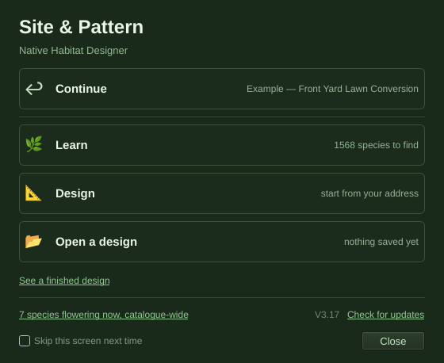
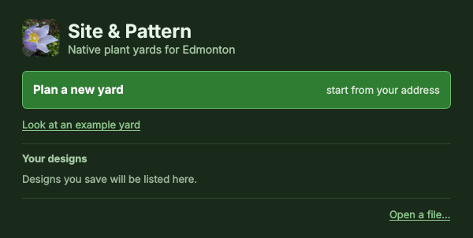
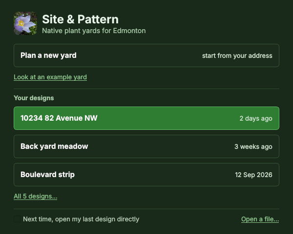
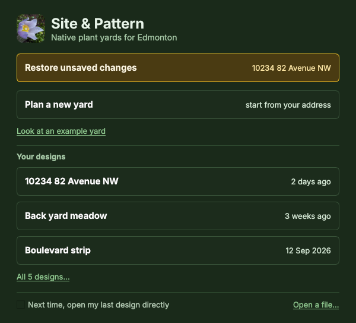

# 4 · The first screen

*Part of the [homeowner-path plan](README.md). Work items **ST-1 to ST-10**;
owner decisions **S1 to S13** (all decisions are collected in
[12-decisions.md](12-decisions.md)). Checked against V3.17's code; where a
claim comes from reading code rather than running it, it says so.*



The owner, with a screenshot of this screen on Windows: *"This feels
unfinished, unpolished, unprofessional. Continue, Open a design, and Design all
are very similar. When you click learn it also opens the regular app. This
needs a review for a rework."*

## Summary

1. **"Learn opens the regular app" is a one-character bug that a safety net
   hid.** `src/learn_flow.py:60` calls `_sandbox_plants()`; the function is
   `sandbox_plants()` (`:95`). The `NameError` is swallowed by `_safely`
   (`learn_flow.py:28-33`), nothing ends up on screen, and `main.py:119-123`
   then shows the design window. Walk a Wild Landscape and Plant Directory open
   their own windows correctly; only *Lessons & Field Study* is dead. It has
   been dead since at least 26 September 2026 (the oldest commit in a shallow
   clone already has it). Fix now (**ST-1**) and add a guard that fails the
   suite on any name nothing defines (**ST-2**).
2. **Three verbs for one job.** *Continue*, *Design* and *Open a design* all
   mean "work on a yard". In the owner's state (a design to continue, no crash)
   **no row is highlighted**: the "one primary" rule is tested as "at most
   one" (`tests/test_start_menu.py:145`), and zero passes.
3. **Most of the screen is not about planning a yard.** Learn leads to a second
   menu of three windows (a 3D world, a flora reference, a photo-ID quiz). The
   footer adds a catalogue-wide bloom count, a version stamp and an update
   link, and *Close* opens the app.
4. **Recommended: "Your designs" (Option B).** One way to start a new yard, the
   example, then the person's own designs listed by name. The Learn door, the
   bloom link, the footer and the emoji go. A design takes its name from its
   address. The simple/advanced choice lives in the main window, not here.
5. **Three small data-safety fixes travel with it:** work from a crash is kept
   if Recover is passed over (**ST-8**), the example opens as a copy (**ST-9**),
   and a design can be renamed (**ST-7**).

---

## 1. What the screen does today

### 1.1 Every state

The screen is built against what is on disk (`src/onboarding_flow.py:122-154`):
the saves folder, the last design's path, a surviving autosave, the catalogue's
counts. It opens before the main window is shown (`main.py:103-105`); the
window is built behind it on a zero-timer, and the catalogue is seeded inside
that construction (`src/app.py:109`).

| State | How it arises | Rows, top to bottom (**primary**) | Notes beside them |
|---|---|---|---|
| S-a. First run | Fresh profile; the database does not exist yet when the screen reads its counts | **Learn** · Design · Open a design; link *See a finished design*; footer *V3.17* · *Check for updates*; checkbox; *Close* | Learn: "start here" (the count read 0); Design: "start from your address"; Open: "nothing saved yet". No bloom link (the count read 0) |
| S-b. Saves, no last design | Saves exist, but the remembered path was moved or deleted (`src/saves.py:247-260`) | **Learn** · Design · Open a design · same links | Learn: "1568 species to find" (424 plants + 1,144 animals); Open: "3 saved"; footer "7 species flowering now, catalogue-wide" (October) |
| S-c. Last design (the owner's screenshot) | `saves.last_design()` returns an existing path | Continue · *(rule)* · Learn · Design · Open a design · links. **No primary** | Continue: the design's `project_name`, usually "Untitled Design"; Learn: "39 of 1568 species discovered" |
| S-d. Autosave pending | The last session ended without a clean exit (`onboarding_flow.py:233-250`) | **Recover unsaved work** · Continue · *(rule)* · Learn · Design · Open a design | Recover: the autosaved design's name |
| S-e. From Help → Welcome | `app.py:585-591` → `show_welcome` → the same `_menu_loop` with `parent=main` | As S-b to S-d | Picking a row acts on the **open** design |
| S-f. Suppressed | "Skip this screen next time" was ticked | No screen; a blank "Untitled Design" map, **not the last design** | Recovery falls back to the controller's own prompt (`controllers/persistence.py:246-299`) |

### 1.2 What each control does

| Control | Code | What happens |
|---|---|---|
| Recover unsaved work | `start_screen.py:195`; `onboarding_flow.py:306-310` | Sets `_recovery_from_menu`, then the Yes/No box in `persistence.py:288-294` |
| Continue | `start_screen.py:197`; `onboarding_flow.py:311-312, 253-263` | `_load_from_path(saves.last_design())` |
| Learn | `start_screen.py:90`; `onboarding_flow.py:112-118` | Opens a second dialog, `LearnMenu` (`learn_menu.py:42-100`); Back loops to the start screen |
| · Walk a wild landscape | `app_mode.py:78`; `onboarding_flow.py:319-320` | `ReferenceEcosystemWindow` (3D, needs WebGL); main window hidden |
| · Plant Directory | `app_mode.py:79`; `onboarding_flow.py:317-318` | `PlantDirectoryWindow`: the picker, 19 filters, "Quiz me on these"; main window hidden |
| · Lessons & Field Study | `app_mode.py:80`; `onboarding_flow.py:321-323` → `learn_flow.open_studio` | **`NameError` at `learn_flow.py:60`, swallowed; the safety net shows the main window.** From Help → Welcome it does nothing visible at all |
| Design | `start_screen.py:91`; `onboarding_flow.py:326-329` | Puts the cursor in Site › Site Info's address box. Does **not** start a new design: at launch the design is the unnamed one from `app.py:118`; from Help it is whatever is open |
| Open a design | `start_screen.py:92`; `onboarding_flow.py:313-314` → `app.py:1890-1912` | `SavesDialog`: the list newest first, plus Browse… |
| See a finished design | `start_screen.py:226-228`; `onboarding_flow.py:442-489` | Rebuilds the example and **overwrites** `<data dir>/example-front-yard-conversion.perma.geojson`, then opens it |
| *N species flowering now, catalogue-wide* | `start_screen.py:236-238`; `onboarding_flow.py:317-318, 370-400` | Opens the main window **and** the Plant Directory filtered to this month |
| V3.17 · Check for updates | `start_screen.py:240-244`; `onboarding_flow.py:324-325` | Main window, then `controllers/update_flow.py:240` |
| Skip this screen next time | `start_screen.py:248-253`; `onboarding_flow.py:151` | Written on every close, so it can be turned back on (good) |
| Close · X · Esc | `start_screen.py:255-257` | Reject → `""` → main window on a blank, unnamed map (`main.py:114-115`) |

### 1.3 How a dead door shipped behind a green suite

Four things lined up, and each is worth a guard:

1. **Python looks a name up only when its line runs.** A rename to the public
   `sandbox_plants` missed one call, and nothing runs that line until somebody
   clicks.
2. **`_safely` discards the exception** (`learn_flow.py:28-33`; the same pattern
   at `onboarding_flow.py:333-340`) with no log line and no message.
3. **The safety net turns "nothing happened" into "the wrong thing happened"**
   (`main.py:119-123`). A working app on the wrong screen beats a silent exit,
   as its comment says; it also makes a broken door look like a design
   decision.
4. **No test opens the door.** `tests/test_learn_mode.py:397-419` builds
   `LearnStudioWindow` directly; the routing tests (`:151-221`) check keys and
   strings, never that a window appears.

A standard-library check (`symtable`) over `src/`, `scripts/`, `tools/`,
`tests/` and `main.py` finds exactly this one undefined name in 654 files, in
under a second ([prototype](prototypes/test_no_undefined_names_prototype.py)).
`pyflakes` agrees (`src/learn_flow.py:60:25: undefined name '_sandbox_plants'`)
but is not a declared dependency, so a test that relied on it could silently
skip.

---

## 2. Diagnosis, element by element

Measured against [`UI_PRINCIPLES.md`](../UI_PRINCIPLES.md) (Krug) and the
[personas](01-personas.md).

| Element | What is wrong | Rule it breaks | Proposal |
|---|---|---|---|
| Continue, Design, Open a design | Three verbs about one thing, a design. The person has to read all three to tell them apart | Krug's first law (`UI_PRINCIPLES.md:19-22`) and second (`:24-27`) | One action to start ("Plan a new yard"), then the person's designs as **nouns**, by name |
| No primary in state S-c | The returning user's state has no obvious row | "Is there one obvious place to start, and only one?" (`:146`) | Exactly one primary in every state, tested with `==` |
| Learn leads (S-a, S-b) | V2.43 put Learn first on purpose (`start_screen.py:86-88`); the persona came to plan a yard, and the owner now ranks the homeowner's path first | Satisficing: people take the first reasonable option (`:40-41`) | Remove the Learn door from this screen (decision S1) |
| "1568 species to find" / "39 of 1568 species discovered" | Counts animals and plants together as a collection game; says nothing about the yard. On first run it reads "start here" because the catalogue does not exist yet | A note should be "a fact about the user's own situation" (`UI_PRINCIPLES.md:131`) | Gone with the Learn door. The new screen reads only the saves folder and the autosave, so first run and later runs cannot differ for that reason |
| Emoji icons 🌿 📐 📂 ↩ ⏱ | Each OS's emoji font draws them differently. ↩ draws as a thin text glyph beside colour emoji. A set-square for "Design" means nothing to the persona | "Looking amateurish" drains goodwill (`:90`); use conventions (`:57-59`) | No icons on rows. The app's own icon (F232, `assets/icon/app_64.png`) once, beside the name |
| Tagline "Native Habitat Designer" | Not the persona's words, and it does not say Edmonton | Self-evident (`:144`) | "Native plant yards for Edmonton" (decision S6); a per-edition string ([08-edmonton-edition.md](08-edmonton-edition.md)) |
| "Untitled Design" | The user is never asked for a name and nothing can rename. Two saves list as two "Untitled Design" rows (`saves.py:148, 90-92`); the PDF prints "Site & Pattern — Untitled Design" (`pdf_export.py:103`) | The changing part must identify the thing | Name from the address, ask once at first save if there is none, allow rename (§5) |
| See a finished design | Good idea, weak wording; it overwrites a saved, edited example (§1.2) | — | "Look at an example yard", opening as a copy (ST-9) |
| Bloom link | Always "catalogue-wide": `site_config["ecoregion"]` is read at `onboarding_flow.py:395` and written nowhere. 7 species in October, 3 of them Edmonton natives. Opens two windows. A flora-reference pull | Eliminate distractions (`:64-65`); the app is not a flora reference | Remove |
| "V3.17", "Check for updates" | The stamp is 3.96 : 1, under the 4.5 : 1 floor the app holds itself to (the start screen is not in the visual-floor walk). The link leaves for a chore | "Can it be read?" (`:162-170`) | Version in the window title, as the main window has had since F231: "Site & Pattern V3.18". The update check stays in Help (decision S11) |
| "Skip this screen next time" | Skipping lands on a blank, unnamed map, not the last design. Its tooltip points to Help, where the entry is "Welcome / Getting Started…" with a stale status tip about Generate (`app.py:585-588`) | Every control does what it says (`:153-156`) | "Next time, open my last design directly", shown only when there is one; the Help entry becomes "Start Screen…" |
| "Close" | Opens the app on a blank, unnamed map; X and Esc do the same | Clickable things do what their words say | No button. At launch X and Esc quit (decision S7); from Help they only close the screen |
| Window chrome | A 560 × 458 px dialog titled "Site & Pattern". Learn replaces it with a second dialog. Focus lands on the first row, not the primary; the yellow ring in the owner's screenshot appears after any key press (`focus_ring.py:105-119`), probably the screenshot key | Hierarchy; Enter should do the obvious thing | One window, 600 px wide, titled with the version; the primary row takes focus and is the default button |

---

## 3. The Learn side: three windows

The owner's direction: the app is **not** a flora reference and certainly not
an identification reference; plant information should help find the right
plants and place them well; there will be a simple and an advanced way to use
the app ([02-two-ways-to-use-it.md](02-two-ways-to-use-it.md)).

| Window | What it is | Also reachable from | For the persona | Recommendation |
|---|---|---|---|---|
| **Walk a Wild Landscape** (`reference_ecosystem_window.py:386-419`) | A 3D reference community you can walk into, plant and pull, with a time slider and "Take into Design". Needs WebGL | View → Walk a Wild Landscape… (`app.py:539-547`) | Beautiful and on-principle (P4, P13), but it produces no plan and assumes a working GPU | **Advanced only.** Keep the window and its View entry; hide the entry in simple mode |
| **Plant Directory** (`plant_directory_window.py:163-184`) | The same picker as Placement › Plants (F192), with 19 filters and "Quiz me on these" | View → Plant Directory… (`app.py:529-537`) | A flora reference by design. The homeowner finds plants in Placement › Plants, against their own site | **Advanced only**, or retire (decision S4). The picker it shares stays |
| **Lessons & Field Study** (`learn_menu.py:105-144`) | A second copy of the main window's Learn tab: Field Study (photo ID, specialist pairs, food-web gaps), Lessons (four short pages: keystones, food web, succession, ranges) and a stray Present tab | The Learn tab (`learn_panel.py:48-50`); Present is also in Share | Field Study's photo questions are plant identification, which the owner has ruled out. The lessons' "your design" read-outs are useful but belong next to the design | **Retire the standalone window.** Field Study: decision S2 (the V3.05 answer was "Keep, and improve"). Lessons: decision S3, recommended to fold their four "your design" lines into the yard overview ([06-yard-overview.md](06-yard-overview.md)) |

**The door itself.** With all three either advanced or duplicated, the Learn
door holds nothing a novice needs. The best "learn" for this persona is the
**example yard**: it shows what a finished plan looks like and leads straight
into the tools. Recommendation: **remove the Learn door and the Learn menu**
(ST-10, after decision S1): delete `LearnMenu`, `LearnStudioWindow`, the door
routing in `app_mode.py`, and `main.py`'s mode gate and safety net. Keep the
discovery ledger (`src/db/progress.py`), which the 3D windows still write.

Fix the dead door first (ST-1) anyway: V3.17 installs carry it, and retiring it
waits on decisions.

---

## 4. Who arrives at this screen

| Visit | What they want | Today | Option B |
|---|---|---|---|
| First launch | "How do I start planning my yard?" | Primary is Learn; "Design" is second and abstract | **Plan a new yard** is the primary row |
| A week later | The yard they started | Continue, not highlighted, named "Untitled Design" | Their design, named "10234 82 Avenue NW", highlighted; Enter opens it |
| Front yard and back yard | Two designs, told apart | "Untitled Design" twice | Named from the address, renameable ("Back yard meadow") |
| After a crash | Their work back | Recover row, primary (good); anything else risks losing it | Same row; anything else keeps the work as a design |
| Planting day | The printed plan | Continue → Share › Export | The design's row → Share › Export |
| Curious, not ready | To see what this produces | "See a finished design" | "Look at an example yard" (opens as a copy) |

---

## 5. Three designs for the screen

Copy rules carried over from `tests/test_start_menu.py`: no prose over eight
words outside a control, notes of five words or fewer, **exactly** one primary
(tightened from "at most one"), every choice acted on. Window titles use
`app_version.running_version()`.

### Option A: tidy the doors (S, about a day)

```
┌ Site & Pattern V3.18 ─────────────────────────────── ✕ ┐
│ Site & Pattern                                          │
│ Native plant yards for Edmonton                         │
│                                                         │
│ [ Restore unsaved changes        10234 82 Avenue NW ]   │  only when an autosave survives; primary then
│ [ Plan a new yard            start from your address ]  │  primary when nothing is saved
│ [ Open a design               10234 82 Avenue NW    ]   │  note = last design's name, else "nothing saved yet";
│                                                         │  primary when a last design exists
│ Look at an example yard                                 │
│ ─────────────────────────────────────────────────────── │
│ ☐ Skip this screen next time                            │
└─────────────────────────────────────────────────────────┘
```

Learn, the bloom link, the footer and the emoji go; X quits. **Weakness:**
continuing takes two clicks (row, then Open), and the note only means something
once designs have names.

### Option B: "Your designs" (M, three to four days with tests). **Recommended**

| First run | Returning |
|---|---|
|  |  |

*Throwaway mock-ups rendered in PyQt under Linux to show proportion and copy;
not the implemented screen. The checkbox shows no box because the mock did not
install the app's indicator style.*

```
First run
┌ Site & Pattern V3.18 ─────────────────────────────── ✕ ┐
│ [icon] Site & Pattern                                   │
│        Native plant yards for Edmonton                  │
│ [█ Plan a new yard           start from your address █] │  primary, focused
│ Look at an example yard                                 │
│ ─────────────────────────────────────────────────────── │
│ Your designs                                            │
│ Designs you save will be listed here.                   │
│ ─────────────────────────────────────────────────────── │
│                                          Open a file…   │
└─────────────────────────────────────────────────────────┘

Returning (five saves; the last one opened first)
│ [ Plan a new yard            start from your address ]  │
│ Look at an example yard                                 │
│ Your designs                                            │
│ [█ 10234 82 Avenue NW                    2 days ago  █] │  primary, focused
│ [ Back yard meadow                       3 weeks ago ]  │
│ [ Boulevard strip                        12 Sep 2026 ]  │
│ All 5 designs…                                          │
│ ☐ Next time, open my last design directly  Open a file… │
```

With an autosave pending, one row is added above "Plan a new yard" and takes the
primary:

```
│ [▓ Restore unsaved changes        10234 82 Avenue NW ▓] │  amber, primary, focused
```



**Exact copy and behaviour**

| Element | Text | Shown when | Does |
|---|---|---|---|
| Window title | `Site & Pattern V3.18` (`Site & Pattern` when there is no version) | always | — |
| Name / tagline | `Site & Pattern` / `Native plant yards for Edmonton` | always | — |
| Recover row | `Restore unsaved changes` · note: the design's name, cut to 32 characters with "…" · tooltip `Site & Pattern closed before these changes were saved.` | an autosave is pending | today's RECOVER |
| New yard row | `Plan a new yard` · note `start from your address` | always | ST-6 `start_new_yard` |
| Example link | `Look at an example yard` · tooltip `A front-yard lawn conversion in central Edmonton. Opens as a copy you can change.` | always | `open_example`, as a copy (ST-9) |
| Section label | `Your designs` | always | — |
| Empty line | `Designs you save will be listed here.` | no designs | — |
| Design rows (up to 3) | title: `project_name` cut to 40 characters (the file name if unreadable) · note: `saves.when()` ("just now", "2 hours ago", "3 days ago", "12 Sep 2026"; "can't be opened" if unreadable) · tooltip: `saves.summary_line()` | one or more designs | opens that path through `_load_from_path` |
| More link | `All 5 designs…` | more than 3 | `main._on_open()` (`SavesDialog`) |
| Checkbox | `Next time, open my last design directly` | a last design exists | stored under the existing key; a suppressed launch opens the last design, else the blank map |
| File link | `Open a file…` · tooltip `Open a design saved somewhere else on this computer.` | always | `main._ask_for_design_file()` → `_load_from_path` |
| X / Esc | — | — | at launch: quit (a new `QUIT` choice; `main.py` closes the hidden window and returns). From Help → Start Screen: just close |
| Help menu | `Start Screen…`, status tip `Your designs, a new yard, or the example yard` | — | `show_welcome` |

**The list.** The saves folder (`saves.list_saves()`), plus the last design if
it lives outside the folder (the example, or a file opened with Browse), sorted
newest first. The primary is the Recover row if present, else the newest
design, else "Plan a new yard". The primary is the dialog's default button and
takes focus, so Enter does the obvious thing.

Counting controls: returning, the screen goes from 9 controls and a stamp to 8
controls, 4 of them the person's own designs; first run goes from 7 to 3.

### Option C: "Where is your yard?" (L, a week or more)

```
│ Site & Pattern                                          │
│ Native plant yards for Edmonton                         │
│ Where is your yard?                                     │
│ [ Street address in Edmonton                 ] [Start]  │  primary
│ Or start on the map                                     │
│ ─────────────────────────────────────────────────────── │
│ Your designs  … (as B)                                  │
```

*Start* geocodes on a worker through `geocode_address` with an Edmonton bias;
one hit opens the main window with the pin placed, zoomed to the lot (first-pass
R7) and the design named; more than one lists them. Offline: `Can't reach the
address search. Start on the map instead.` The strongest first step, but it
moves the network onto the front door, and its offline path must be first-class.

### Recommendation

**Option B.** It answers the owner's complaint directly: one way to start, then
the person's own designs as named things; it reads nothing but the saves folder
and the autosave. Build C's address box later, if at all, as the first step of
the guided flow inside the main window ([07-plan-my-yard.md](07-plan-my-yard.md)),
and only if watching real homeowners shows the address step is where people
stall. A home page *inside* the main window (Word's File → Home) was considered
and rejected: it would undo V2.40's decision to show the choice before the map
and rewrite the launch-order tests (`test_start_menu.py:268-372`) for little
gain.

**The start screen does not ask "simple or advanced?"** and looks the same in
both. That choice lives in the main window as a remembered switch, off by
default; [02-two-ways-to-use-it.md](02-two-ways-to-use-it.md) explains why
this avoids V2.42's objection to a mode toggle.

---

## 6. Names, and what Continue and Open become

*Continue* and *Open* become **Your designs**: the most recent design is the
primary row, "All N designs…" opens the existing `SavesDialog`, "Open a file…"
is the OS dialog.

**A design gets a real name in four steps.**

1. **From the address, automatically (ST-5).** A new Qt-free
   `src/design_name.py`:
   - `PLACEHOLDER = "Untitled Design"` and `is_placeholder(name)`;
   - `from_address(label)` turns Nominatim's `display_name` into a short name:
     `"10234, 82 Avenue NW, Strathcona, Edmonton, Alberta, T6E 1Z8, Canada"` →
     `"10234 82 Avenue NW"`; `"Ritchie, Edmonton, Alberta, Canada"` →
     `"Ritchie"`; a coordinate label (`"53.54321, -113.49876"`) → `""`. Rule:
     if the first comma part is a house number, join it to the second;
     otherwise take the first; at most 60 characters; never raises.

   `controllers/map_events.py` `_on_site_pin_placed` (`:739-745`) renames the
   design when its name is still the placeholder and a label arrives, and
   retitles the window. That covers the address search and a dropped pin's
   reverse-geocoded label (the page re-places the pin with the label, which
   calls `onSitePinPlaced` again, `html/map/06-overlays.js:1268-1270`). A
   dragged pin sends `''` and renames nothing.
2. **Asked once, at the first save, only if there is still no name.**
   `controllers/persistence.py` `_on_save` (`:167-180`) shows a `QInputDialog`:
   title `Save design`, label `Name this design:`, text `My yard`; Cancel
   cancels the save.
3. **Never asked when starting (ST-6).** File → New's `Project name:` prompt
   (`app.py:1848-1853`) goes; the start screen, File → New and Help → Start
   Screen share one `start_new_yard(main)`.
4. **Renameable (ST-7).** A `Rename…` button in `SavesDialog`, and File →
   `Rename Design…` for the open one. Today the only route is Save As, which
   leaves the name inside the file unchanged.

Names then reach the window title, the saves list and the PDF's title
(`pdf_export.py:103`), which closes first-pass R34.

---

## 7. The dead door: fix, regression test, guard, visible failure

**Fix (ST-1).** `src/learn_flow.py:60`: `plants, title = _sandbox_plants()` →
`plants, title = sandbox_plants()`.

**Regression test**, in `tests/test_learn_mode.py` under `TestTheLearnScreens`
(which already redirects the data directory):

```python
def test_the_lessons_door_opens_its_window(self):
    """V3.17 shipped this door dead: a NameError swallowed by _safely, then
    main.py's safety net showed the design window instead."""
    from types import SimpleNamespace
    from src import learn_flow
    from src.learn_menu import LearnStudioWindow
    main = SimpleNamespace()
    learn_flow.open_studio(main)
    win = getattr(main, "_learn_studio", None)
    self.assertIsInstance(win, LearnStudioWindow, "the Lessons door opened nothing")
    self.assertTrue(win.isVisible())
    win.close()
```

Prototyped outside the repository: it fails on V3.17 ("the Lessons door opened
nothing") and passes with the name fixed.

**Whole-launch test (with ST-4 or ST-10).** A new `tests/test_start_doors_open.py`
(needs `PyQt6.QtWebEngineWidgets`, which CI has). For each choice the screen
offers, patch `StartScreen.exec` (and `LearnMenu.exec` while it exists) to pick
it, run `main.py`'s sequence (`choose_start_action`, `MainWindow()`, the gate,
`act_on_start_choice`), process events for up to 2 s, and assert that exactly
the expected top-level window is visible; for a Learn-only key the main window
must stay hidden and the safety net must not fire. Close every window with
`close()` before `deleteLater()` (CLAUDE.md's QThread rule).

**Guard (ST-2).** `tests/test_no_undefined_names.py`, standard library only: parse
every `.py` under `src/`, `scripts/`, `tools/`, `tests/`, plus `main.py`, with
`symtable`; fail on any name a function or class body uses that the module, its
imports, `global` assignments and the builtins do not define; include a
self-test on a two-line string holding this exact bug; wrap the parse in
`warnings.catch_warnings()` (`scripts/fetch_inaturalist_images.py:42` emits a
`SyntaxWarning`). The [prototype](prototypes/test_no_undefined_names_prototype.py)
runs in 0.7 s and fails today with:
`src/learn_flow.py: _go() (from line 59) uses '_sandbox_plants', which nothing defines`.

**A failed door says so (ST-3).** Both `_safely`s (`learn_flow.py:28-33`,
`onboarding_flow.py:333-340`) take a `what` argument and call a new public
`slot_errors.report(what)`, which logs the traceback and, only when the app's
hook is installed (`sys.excepthook is _hook`, so never in tests), shows once per
fault a non-blocking box titled `Something went wrong`:

> The Lessons could not open, and the app carried on without them.
> What went wrong: NameError: name '_sandbox_plants' is not defined
> A full record is in the log: *path*
> Help → Send Feedback… tells the author.

The `what` strings: `The Lessons`, `The Plant Directory`, `Walk a Wild
Landscape`, `The update check`, `The address search`. `main.py:119-123` keeps
showing the main window but logs `Start choice %r left no window on screen;
showing the main window`. If ST-10 retires the Learn-only choices, the net has
nothing left to catch and goes with the gate.

---

## 8. Tests that change

| Test | Line | Change |
|---|---|---|
| `test_start_menu.py` `test_a_first_time_user_sees_only_the_three_doors` | 56-62 | One row (`Plan a new yard`), primary; the empty-state line; no Recover or design rows |
| `…test_the_three_doors_do_not_rearrange_between_launches` | 64-72 | Keep the idea: "Plan a new yard" and `Your designs` sit at the same index with and without saves |
| `…test_having_saves_does_not_add_a_continue_row` | 74-77 | Retire (there is no Continue row) |
| `…test_a_last_design_adds_continue_and_names_it` | 79-85 | Each design is a row titled with its name, noted with `saves.when()` |
| `…test_a_row_says_a_fact_about_you…` | 120-134 | Drop "3 saved" and the species count; keep the five-word note limit |
| `…test_exactly_one_row_is_the_obvious_one` | 136-145 | `assertEqual(len(primary), 1)` across all states; the primary has focus and is the default |
| `…test_every_row_returns_a_choice_the_flow_handles` | 147-160 | RECOVER, NEW_YARD, EXAMPLE, OPEN_PATH, ALL_DESIGNS, OPEN_FILE, QUIT |
| `…test_the_checkbox_is_still_there` | 260-265 | New text; present only when a last design exists |
| `…test_choosing_a_row_before_any_window_exists…` | 392-430 | Click `Plan a new yard`; `choose_start_action()` returns `StartChoice(key, path)` |
| `…TestAChoiceAfterTheMapHasLoaded` | 591-638 | New keys (`open-path`, `example`, `recover`) |
| `test_onboarding.py` `TestStartScreen` | 317-329 | `_DOORS` is gone; test the new constants |
| `test_keyboard_baseline.py` `test_the_start_screens_choices_are_named` | 463-475 | Rows named by design name; ≥ 3 rows with two saves |
| `test_sun_shade.py` | 540-546 | `_NEEDS_MAP` holds OPEN_PATH, EXAMPLE, RECOVER; drop DIRECTORY and REFERENCE |
| `test_learn_mode.py` `TestTheDoorSplit`, `TestTheLearnScreens` | 151-221, 356-419 | Retire with ST-10; keep the ledger, sandbox and bridge classes |
| `test_viewer_controls.py` `test_learn_mode_does_not_get_it` | 278-287 | Reads `learn_flow.py` and `learn_menu.py`; retire or repoint with ST-10 |
| `test_architecture_guard.py` ceilings | 326-335 | Remove `learn_flow`, `learn_menu`, `app_mode` if deleted; `start_screen.py` 380 stays |
| `scripts/surface_inventory.py` | 1040-1041 | Stops opening the Learn menu |
| **New:** `test_no_undefined_names.py`, `test_start_doors_open.py`, `test_design_name.py` | — | §7 and §6 |
| **New:** the start screen in the visual floor | — | Run `tests/_visual.py`'s contrast, 12 px and 24 px checks on `StartScreen` in every state (ST-4) |

Docs to update with ST-4: [`UI_PRINCIPLES.md`](../UI_PRINCIPLES.md) `:121-140`
(a row for this rewrite) and `:172-181` ("exactly one primary"), and the
CLAUDE.md row for `src/onboarding.py` + `src/onboarding_flow.py`.

---

## 9. Work items

| ID | Item | Effort | Depends on |
|---|---|---|---|
| **ST-1** | **Fix the dead Lessons door.** `learn_flow.py:60`. Add the regression test in §7. *Accept:* the test fails on V3.17 and passes after; under Xvfb, Learn → Lessons & Field Study opens a window titled "Site & Pattern: Lessons" and the main window stays hidden | S | — |
| **ST-2** | **Guard: no undefined names.** `tests/test_no_undefined_names.py` (§7). *Accept:* before ST-1 it fails naming exactly the `learn_flow.py` scope; after, it passes; covers `src/`, `scripts/`, `tools/`, `tests/`, `main.py`; under 2 s; never skips | S | ST-1 to go green |
| **ST-3** | **A start-screen action that fails says so.** `slot_errors.report(what)`; both `_safely`s call it; `main.py`'s net logs. Touch: `src/slot_errors.py:71-137`, `src/learn_flow.py:28-33`, `src/onboarding_flow.py:333-340`, `main.py:119-123`. Tests: `report()` logs and does not show a box when the hook is absent; `_safely(lambda: 1/0, 'X')` logs 'X' at ERROR (`assertLogs`). *Accept:* with ST-1's bug reintroduced locally, choosing Lessons shows "Something went wrong — The Lessons could not open…" and `logs/app.log` holds the traceback; in tests no box opens | S | — |
| **ST-4** | **Rebuild the start screen as "Your designs" (Option B).** `StartScreen(parent, *, recover='', designs=(), total=0, show_skip=False, hidden=False, version='')`; rows without icons; the app icon beside the name; copy as §5; one primary with `setDefault(True)` and focus; note text on a green row `#ffffff` (5.13 : 1); choices RECOVER, NEW_YARD, EXAMPLE, OPEN_PATH (+ `chosen_path()`), ALL_DESIGNS, OPEN_FILE, QUIT. `onboarding_flow.py` is at 571 of 620 lines: put new glue in a new `src/start_flow.py`. Touch: `src/start_screen.py`, `src/onboarding_flow.py:93-154, 161, 298-330, 360-429`, `main.py:103-125`, `src/app.py:585-591`, `src/branding.py:29`, `src/saves.py:165-223`. Tests: §8. *Accept:* screenshots in all states match §5's copy; exactly one highlighted row, Enter activates it; no emoji; passes the visual floor in every state; X at launch quits, from Help only closes; a design row opens that design. Keep `window.show()` and `act_on_start_choice` in `main.py` so the launch-order AST tests (`test_start_menu.py:268-372`) pass | M | S1, S6, S7, S8, S12; pairs with ST-5, ST-6 |
| **ST-5** | **A design takes its name from its address.** `src/design_name.py` (§6); `controllers/map_events.py:739-745`; `controllers/persistence.py:167-180`. Tests: `tests/test_design_name.py` (house address, point of interest, neighbourhood, coordinates, `''`); a stub-main test that a placeholder design is renamed by a labelled pin, a named one is not, `''` renames nothing. *Accept:* search an address and pick the hit: the title and, after Save, the saves list read the street address; dragging the pin does not rename; a name the user gave is never replaced; saving an unnamed, pinless design asks once | S | — |
| **ST-6** | **One way to start a new yard.** `start_new_yard(main)`: if modified, ask `Discard unsaved changes to "<name>" and start a new yard?`; reset via a function extracted from `app.py:1855-1888` (without the name prompt at `:1848-1853`); then focus the address search (or the guided flow's first step when it lands). NEW_YARD and File → New both call it; wire through a lambda so MainWindow's method count does not grow (`test_architecture_guard.py:545`). *Accept:* from Help → Start Screen with a design open, Plan a new yard gives an empty, placeholder-named design after confirmation, never the old design with the cursor in its address box; File → New no longer asks for a name | S | S9 |
| **ST-7** | **Rename a design.** `saves.rename_save(path, new_name)` (load, set `project_name`, save to `unique_save_path`, remove the old file, return the new path); `Rename…` in `SavesDialog` (`saves_dialog.py:66-87`); File → `Rename Design…` updates `_project`, `_project_path`, `saves.remember_last_design` and the title. Tests in `tests/test_saves.py`. *Accept:* renaming changes the row, the file name and the title; no file is overwritten | S | ST-5 |
| **ST-8** | **Unsaved work is kept when Recover is passed over.** Found by reading the code (`persistence.py:224-236, 280-284`): the single autosave file is overwritten by the next session's autosave after five minutes of changes. When the screen showed Recover and the choice is anything else, move the autosave into the saves folder as `<name> (unsaved changes from 12 Oct)` and delete it. *Accept:* crash with edits, relaunch, choose Plan a new yard: the old work is listed under that name and opens intact; no autosave remains | S | S13; ST-4 for the list |
| **ST-9** | **The example opens as a copy.** In `open_example` after `_load_from_path` (`onboarding_flow.py:472`) set `main._project_path = None`; status note `Opened the example yard. Changes you save go to Your designs.` *Accept:* open, change, Save: a new file appears in the saves folder; open the example again: pristine | S | — |
| **ST-10** | **Retire the Learn door and its menu.** Remove LEARN from the start screen; reduce `_menu_loop` to one call; delete `LearnMenu`, `LearnStudioWindow`, `open_learn_menu`, `open_studio`, `plant_line`, `discovery_line`, and `app_mode.py`; remove the gate and net in `main.py:107-123` (always `window.show()`); drop the STUDIO, DIRECTORY and REFERENCE branches in `_dispatch`; keep `src/db/progress.py`. Record the reversal of V2.43's two-door argument in the increment's plan file. *Accept:* no Learn row or menu; every start choice leaves exactly one visible window (`test_start_doors_open`); View → Plant Directory and Walk a Wild Landscape still open (advanced); suite green within the skip ceiling | M | S1–S5; ST-1 shipped first |

## 10. What could not be checked

- The owner's Windows screenshot was seen, but emoji, the title bar and the
  taskbar entry were only run on Linux under Xvfb.
- Whether closing a Learn window while the main window is hidden ends the app
  (expected from Qt's quit-on-last-window rule; not observed).
- Why the focus ring sat on Continue in the screenshot (inferred: any key press
  shows it).
- The autosave-overwrite loss (ST-8) was found by reading the code, not by a
  five-minute run.
- Nominatim's `display_name` formats used for naming come from documentation,
  not live calls (every data host was blocked in the review session).
- The 3D Walk window's contents (no WebGL in the review session).
